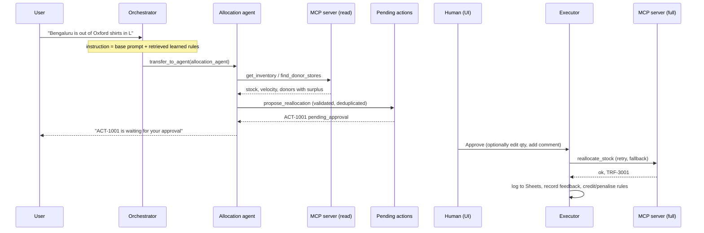
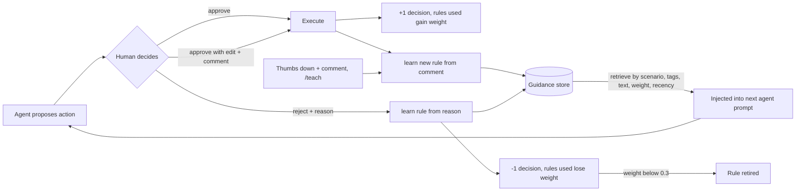
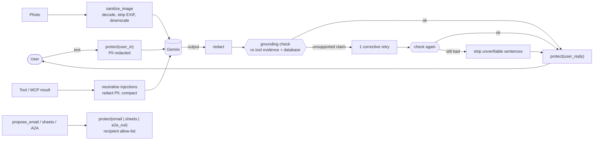
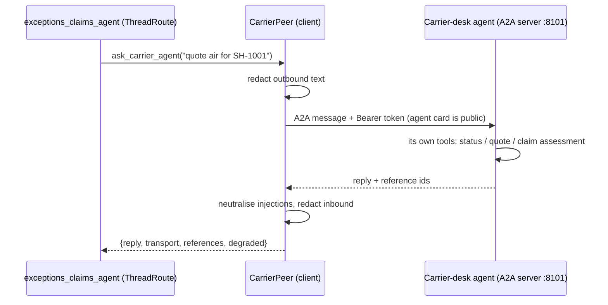

# ThreadRoute architecture

## 1. System overview

## 2. One request, step by step

## 3. Self-healing layers

| Layer | Failure | Automatic response | Where |
|---|---|---|---|
| Transport | HTTP 429/5xx from Gemini | exponential-backoff retries | `agents/models.py` |
| Model | primary model unavailable or unknown | walk the fallback model list, then degrade to a plain-language message | `agents/callbacks.py::on_model_error` |
| Tool call | exception inside a tool | convert to a structured error with a hint; the model corrects itself or reports it | `agents/callbacks.py::on_tool_error` |
| Model output | wrong enum / impossible quantity | validation error returned to the model so it repairs its own arguments; nothing is queued | `agents/tools.py::_propose` |
| External API | timeout, error, malformed payload | retry with backoff, then next provider in the chain (primary -> secondary -> cache/estimate); result flagged `degraded` | `resilience/resilient.py` |
| Repeated failure | provider keeps failing | circuit breaker opens; watchdog demotes it for 2 minutes and may raise timeouts or retries | `resilience/breaker.py`, `watchdog.py` |
| MCP subprocess | write server cannot start | fall back to the same domain function in-process (the human already approved) | `approvals/executor.py` |
| Recovery | the outage ends | demotion expires / `chaos clear` restores order; a half-open breaker probes the primary | `breaker.py` |

Every healing action is written to `healing_events`, shown in the UI "Self-healing" tab and counted in the report.

## 4. Feedback loop

* A rule is created from any rejection reason, any edit that comes with a comment, a thumbs-down comment, or `/teach`.
* Near-duplicate rules are merged and their weight grows (max 5).
* Retrieval scores each rule by scenario match, shared tags (carrier, category, mode, city, weather terms), text overlap, weight and age.
* The report compares approval rate with and without learned guidance applied.

## 5. Safety design

* **Approval gate.** The LLM has no tool that approves or executes. `propose_*` only writes a pending row; only the REST endpoint / CLI command (a person) can approve.
* **Read-only MCP for agents.** Agent toolsets connect to a server started with `THREADROUTE_MCP_MODE=read`, in which write tools are not even registered. Only the executor starts the server in `full` mode.
* **Business rules live in one place** (`domain/wms.py`) and are re-checked at execution time, so stock that changed after a proposal cannot be over-allocated.
* **Idempotent proposals.** Identical pending proposals in a session collapse into one.
* **No secrets in code.** Keys come from `.env` / environment; `.env`, tokens and databases are git-ignored.
* **Untrusted content.** Text read from photos is treated as data; the agents verify ids against the WMS before proposing anything, and anything with side effects still needs a human.

## 6. Guardrails: the egress choke point

Every boundary calls the same function, `guardrails.egress.protect(destination, obj)`, so there is one place to audit and one place that can be wrong.

Redaction is one-way (placeholders like `[EMAIL_1]`; the vault keeps hashes only), so nothing downstream can reconstruct a value. The audit counters record *kinds and counts*, never values.

## 7. A2A: two agents, two owners

Transport chain with the same resilience treatment as every other dependency: `a2a_http` → `a2a_inprocess` (same protocol objects over an ASGI transport) → `local_policy` (flagged `degraded`). ThreadRoute can also be served as an A2A agent (`a2a-serve`).

## 8. Evaluation architecture

* `evaluation/claims.py` extracts checkable claims (ids, numbers + units, money in INR/lakh/crore, dates, "I did X" statements).
* `evidence.py` records what the model was actually shown by tools in the current turn (post-redaction, post-compaction).
* `evaluation/grounding.py::check` compares claims with (a) the evidence and the user's text → **groundedness**, (b) the database through `evaluation/oracle.py` → **truthfulness**, (c) the approval log → **false action claims**, and flags **fabricated ids** and **PII**. Allowed derivations (sums, differences, day counts, rounding) are accounted for.
* `agents/runtime.py::_verify_and_repair` is the runtime guard (check → one retry → strip).
* `evaluation/runner.py` is the offline/live harness; `evaluation/selftest.py` measures the checker itself; `evaluation/judge.py` is an optional LLM second opinion.

## 9. Performance and token flow

* **Hot path has no I/O beyond the model and tools:** timings go to bounded in-memory deques; resilience events/stats are queued to a background writer (flushed every 1.5 s, at exit and before any read); config and chaos probes are cached.
* **Parallelism:** independent lookups run under `asyncio.gather` (reroute comparison); the MCP server is started once and shared by all agents, each keeping its own tool allow-list.
* **Caching:** `perf/cache.py` caches only good carrier/weather/route answers for a short TTL and is cleared on every state change.
* **Context size:** `optimize.py` normalises MCP results, drops nulls, truncates long lists and compacts history (old images and bulky old tool results) before each model call; `before_model` enforces the session token budget and the per-turn call cap.
* **Accounting:** `perf/tokens.py` records real usage when the API reports it (chars/4 estimate otherwise, flagged) and prices it from `config/pricing.yaml`.
