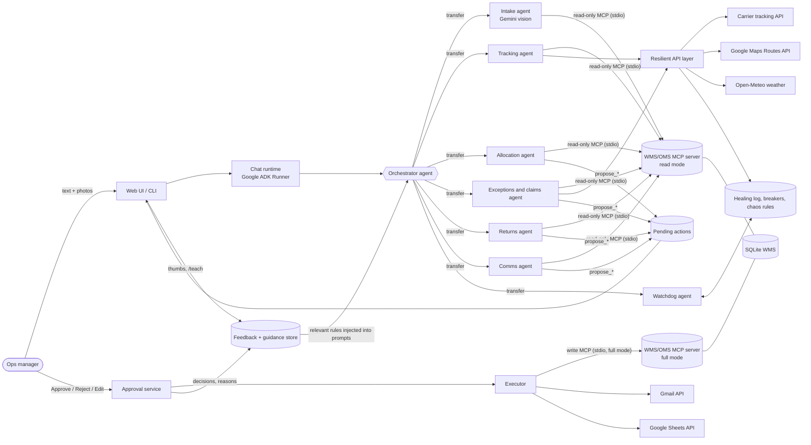
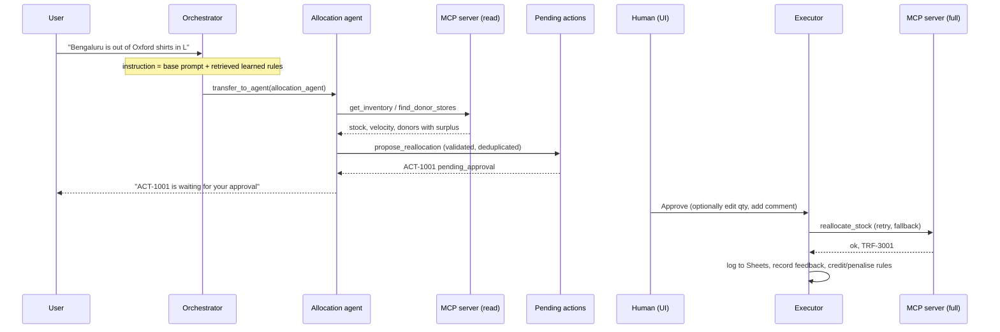
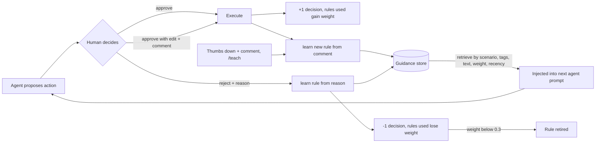

# ThreadRoute architecture

## 1. System overview

## 2. One request, step by step

## 3. Self-healing layers

| Layer | Failure | Automatic response | Where |
|---|---|---|---|
| Transport | HTTP 429/5xx from Gemini | exponential-backoff retries | `agents/models.py` |
| Model | primary model unavailable or unknown | walk the fallback model list, then degrade to a plain-language message | `agents/callbacks.py::on_model_error` |
| Tool call | exception inside a tool | convert to a structured error with a hint; the model corrects itself or reports it | `agents/callbacks.py::on_tool_error` |
| Model output | wrong enum / impossible quantity | validation error returned to the model so it repairs its own arguments; nothing is queued | `agents/tools.py::_propose` |
| External API | timeout, error, malformed payload | retry with backoff, then next provider in the chain (primary -> secondary -> cache/estimate); result flagged `degraded` | `resilience/resilient.py` |
| Repeated failure | provider keeps failing | circuit breaker opens; watchdog demotes it for 2 minutes and may raise timeouts or retries | `resilience/breaker.py`, `watchdog.py` |
| MCP subprocess | write server cannot start | fall back to the same domain function in-process (the human already approved) | `approvals/executor.py` |
| Recovery | the outage ends | demotion expires / `chaos clear` restores order; a half-open breaker probes the primary | `breaker.py` |

Every healing action is written to `healing_events`, shown in the UI "Self-healing" tab and counted in the report.

## 4. Feedback loop

* A rule is created from any rejection reason, any edit that comes with a comment, a thumbs-down comment, or `/teach`.
* Near-duplicate rules are merged and their weight grows (max 5).
* Retrieval scores each rule by scenario match, shared tags (carrier, category, mode, city, weather terms), text overlap, weight and age.
* The report compares approval rate with and without learned guidance applied.

## 5. Safety design

* **Approval gate.** The LLM has no tool that approves or executes. `propose_*` only writes a pending row; only the REST endpoint / CLI command (a person) can approve.
* **Read-only MCP for agents.** Agent toolsets connect to a server started with `THREADROUTE_MCP_MODE=read`, in which write tools are not even registered. Only the executor starts the server in `full` mode.
* **Business rules live in one place** (`domain/wms.py`) and are re-checked at execution time, so stock that changed after a proposal cannot be over-allocated.
* **Idempotent proposals.** Identical pending proposals in a session collapse into one.
* **No secrets in code.** Keys come from `.env` / environment; `.env`, tokens and databases are git-ignored.
* **Untrusted content.** Text read from photos is treated as data; the agents verify ids against the WMS before proposing anything, and anything with side effects still needs a human.
